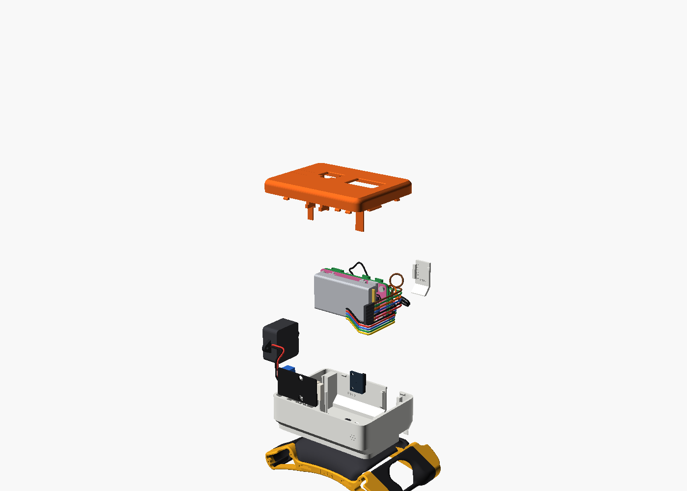
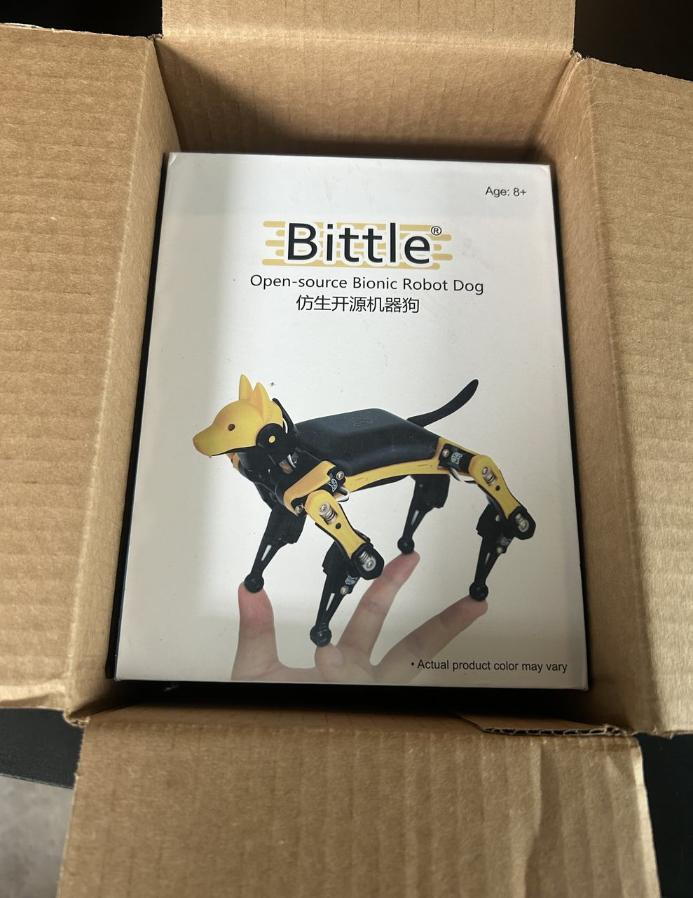
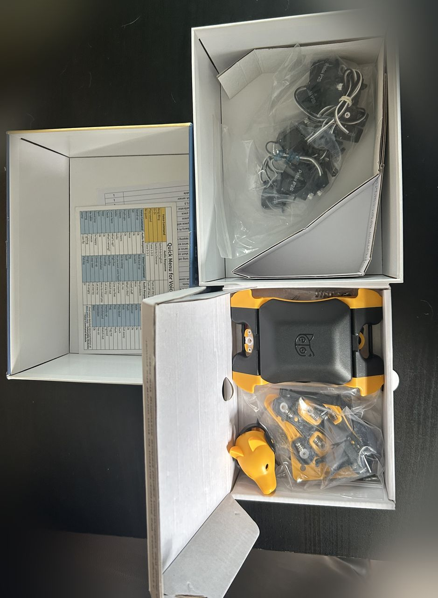
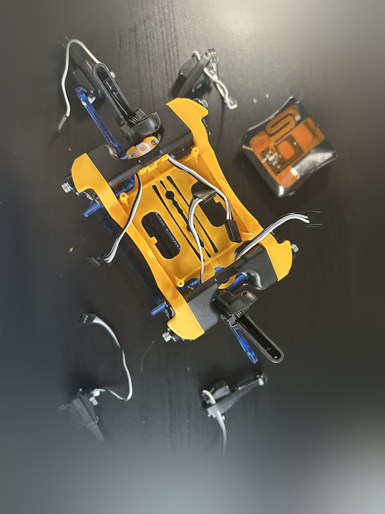

# Assembly sequence

The order G2 was built in, with the page that holds the detail for each step. Follow it top to bottom to reproduce the hardware; each step links to the page that holds the detail. For the current state of the hardware see [`../docs/hardware/as-built.md`](../docs/hardware/as-built.md).

1. Mount the PiSugar S under the Pi Zero 2 W (pogo-pin contact, header stays free)
2. Assemble the Bittle X V2 frame, servos and BiBoard from Petoi's kit. See: Petoi's assembly guide
3. Erase and reflash the BiBoard with the current official OpenCat firmware. See: [`../docs/hardware/petoi-firmware-reference.md`](../docs/hardware/petoi-firmware-reference.md)
4. Calibrate the eight leg servos with the bracket and verify with `kbalance`. See: [`calibration.md`](calibration.md)
5. Prepare the BiBoard's 5-pin Pi socket (solder the header)
6. Wire Pi to BiBoard: TX, RX and GND only (data, no 5 V). See: [wiring guide](wiring.md)
7. Enable Serial-2 on the BiBoard (`XS`) and check the link (`check_serial ping`). See: [`../docs/guides/pi-bring-up.md`](../docs/guides/pi-bring-up.md)
8. Connect the camera module to the Pi's USB port. See: [`../docs/vision/README.md`](../docs/vision/README.md)
9. Wire the I2S microphone and amplifier to the Pi header
10. Mount the Pi stack, camera, speaker and microphone in the Bittle X Pi add-on pod on the platform cover (an interim mount used a modified back cover). See: [`mounting.md`](mounting.md)
11. Replace the front-left shoulder servo and re-run calibration. See: [`calibration.md`](calibration.md)

Photos of the build
-------------------

 and the PiSugar S battery board (left) before stacking.")

After the hardware is together, [Reproducing G2](../docs/guides/reproduce-g2.md) is the ordered software and first-movement bring-up (the guided version is `python -m pi_pipeline.bringup`).

Not part of the build: the Petoi AI Head and the arm module. Its wiring, if it is ever added, is Part 2 of the wiring guide.
