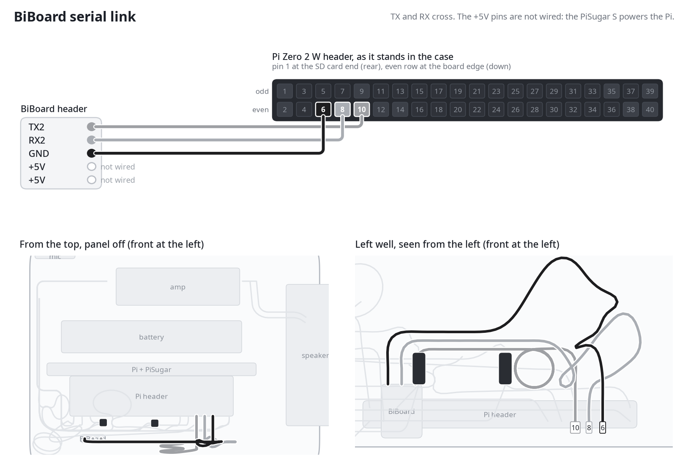
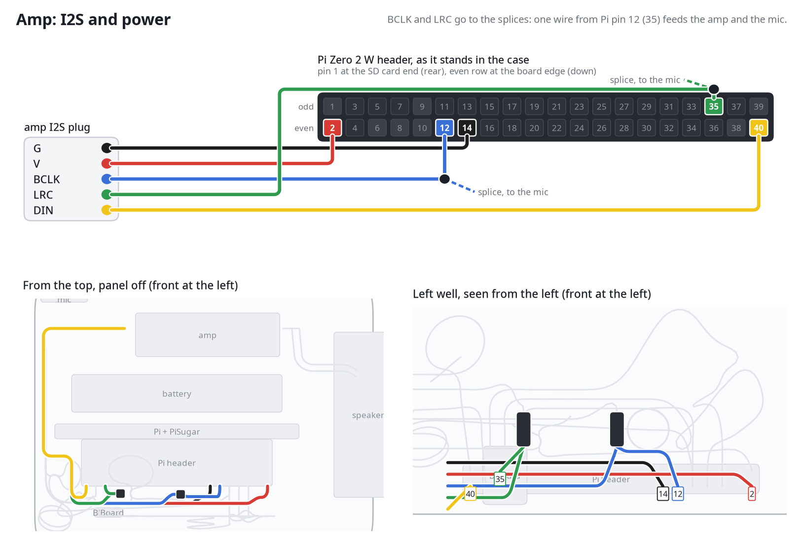
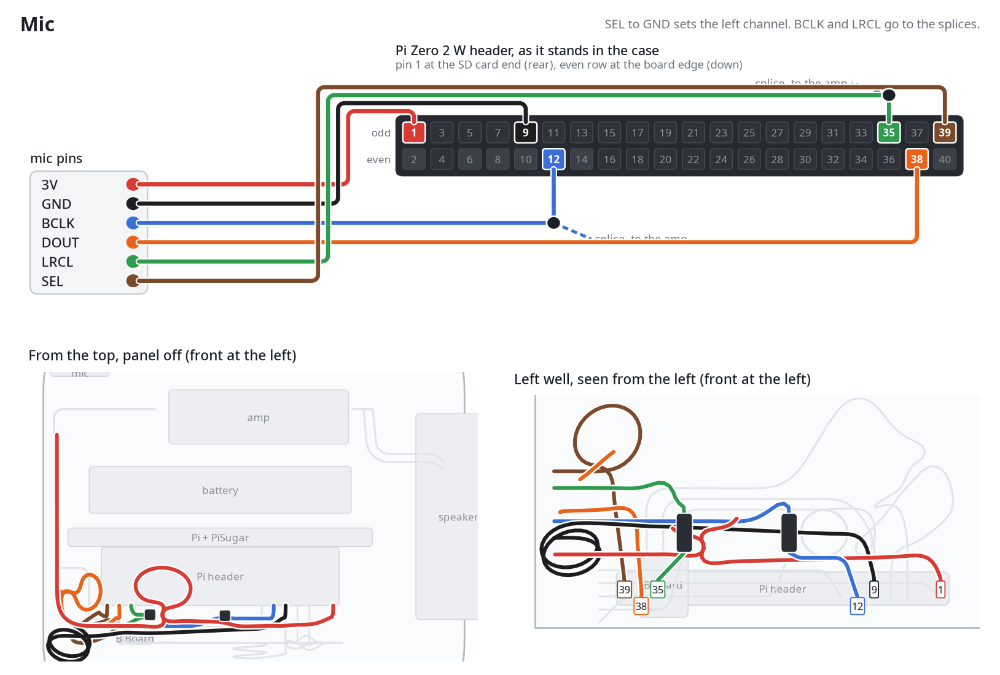
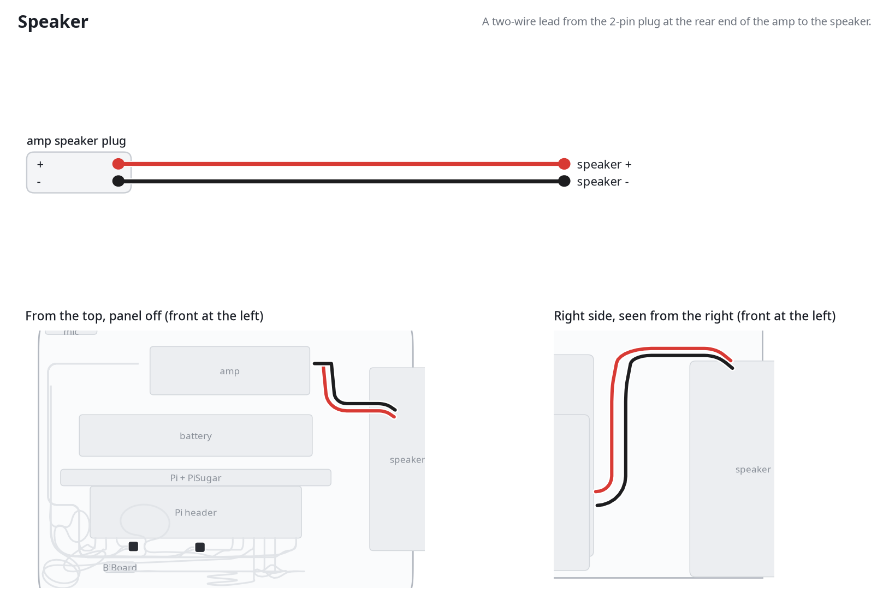

# Wiring guide

This page specifies every wire and contact inside G2. Part 1 covers the power and brain stack: the PiSugar under the Pi, and the Pi wired to the BiBoard. Part 2 covers everything else wired into the Pi: the microphone and amplifier, and the Petoi AI head.

Part 1: PiSugar, Pi and BiBoard
-------------------------------

The PiSugar powers the Pi through contact pins, and the Pi talks to the BiBoard over a three-wire serial link.

### 1.1 Stack and power

The PiSugar powers the Pi through its pogo pins, so the BiBoard's +5V pins and the Pi's pin 2 carry no supply for this link.

### 1.2 PiSugar to Pi (contact, no wires)

- Mounting: Four screws hold the PiSugar under the Pi. The holes are symmetric, so it bolts on in two rotations and only one powers the Pi.
- Correct orientation: The PiSugar's micro-USB port, switch and battery end up under the Pi's mini-HDMI and USB edge, and its pogo pins land under the 40-pin header.
- Check: The pogo pins sit on the header's solder joints before the screws are tightened. The screws fit either way.

The pogo pins contact these Pi pins (inferred):
- 5V: Pi pin 2
- 5V: Pi pin 4
- SCL (auto-start): Pi pin 5
- GND: Pi pin 6
- GND: Pi pin 6 or nearby

The 2, 4, 5 and 6 range is confirmed by the PiSugar's PCB legend and FAQ. The pin-by-pin match is not independently verified.

### 1.3 Pi to BiBoard (three wires, crossed)

The BiBoard's 5-pin Pi header sits at the head-facing edge, above the G1 Grove socket. From left to right it is TX2 (square pad), RX2, GND, +5V, +5V. A 5-pin header is soldered there if none is fitted.

- BiBoard TX2: Pi pin 10, GPIO15 (RXD)
- BiBoard RX2: Pi pin 8, GPIO14 (TXD)
- BiBoard GND: Pi pin 6, GND
- BiBoard +5V and +5V: not wired, because the PiSugar powers the Pi

TX and RX cross: each board's transmit line goes to the other's receive line. Pi TXD (pin 8) carries the Pi's outgoing data to BiBoard RX2, and BiBoard TX2 goes to Pi RXD (pin 10). Ground runs straight across. The jumpers are long enough to reach the header at the final mounting position (20 to 30 cm if the Pi sits at the back edge).

### 1.4 Before power-on

1. Both of the BiBoard's +5V pins are empty.
2. No BiBoard wire is on the Pi's pin 2. Pin 2 does carry the amp's 5 V in Part 2, and that is a separate wire.
3. BiBoard TX2 goes to Pi pin 10, not pin 8. They are easy to swap.
4. All three wires are seated at both ends.

Part 2: Everything wired into the Pi
------------------------------------

Once Part 1 is built, the Pi's 40-pin header also feeds the audio pair. The AI head connects to the BiBoard by its Grove cable and to the Pi over Wi-Fi, so it adds no wires to the header.

### 2.1 Header map

Pin 1 is top-left and pin 2 top-right, running down to pins 39 and 40. Odd pins are on the left and even pins on the right. The pins PiSugar also touches are 2, 4, 5 and 6.

- Pins 1 and 2: 3V3 is the mic VIN. 5V is the amp VIN and the PiSugar 5V.
- Pins 3 and 4: GPIO2 (SDA) is free. 5V is the PiSugar contact.
- Pins 5 and 6: GPIO3 (SCL) is the PiSugar auto-start tap. GND is the BiBoard GND.
- Pins 7 and 8: GPIO4 is free. GPIO14 (TXD) is the BiBoard RX2.
- Pins 9 and 10: GND is the mic or amp GND. GPIO15 (RXD) is the BiBoard TX2.
- Pins 11 and 12: GPIO17 is free. GPIO18 is BCLK, spliced to the mic and amp.
- Pins 13 and 14: GPIO27 is free. GND is free (the amp G is shown here, but any free GND pin works).
- Pins 15 and 16: GPIO22 and GPIO23 are free.
- Pins 17 and 18: 3V3 and GPIO24 are free.
- Pins 19 and 20: GPIO10 (MOSI) and GND are free.
- Pins 21 and 22: GPIO9 (MISO) and GPIO25 are free.
- Pins 23 and 24: GPIO11 (SCLK) and GPIO8 (CE0) are free.
- Pins 25 and 26: GND and GPIO7 (CE1) are free.
- Pins 27 and 28: ID_SD and ID_SC are reserved for the HAT EEPROM.
- Pins 29 and 30: GPIO5 and GND are free.
- Pins 31 and 32: GPIO6 and GPIO12 are free.
- Pins 33 and 34: GPIO13 and GND are free.
- Pins 35 and 36: GPIO19 is LRCLK, spliced to the mic and amp. GPIO16 is the amp CTRL, which needs no connection.
- Pins 37 and 38: GPIO26 is free. GPIO20 is the mic DOUT.
- Pins 39 and 40: GND is the mic SEL, tied to ground. GPIO21 is the amp DIN.

### Wire map

- BiBoard wires: They land on pins 6, 8 and 10 in the right column, so they loop over the top of the header to reach it.
- Clock splices: The Pi drives BCLK and LRCLK only from pins 12 and 35, so each feeds a splice (thick wire, dot, ×2) that fans out to both the mic and the amp.
- Amp ground: The amp G is shown on pin 14, but any free GND pin works.
- Mic SEL: It is tied to ground with a wire to pin 39, a GND pin. It is a fixed channel-select level, not a data signal.
- Crossings: Board ports are in the order printed on each board (the mic top to bottom as read, the amp in plug order), so wires cross where those orders disagree with the header's pin order.
- AI head: The head (yellow) connects to the BiBoard G1 by its four-pin Grove cable. Its Wi-Fi links (trigger, voice, mic stream) need no wire.

### 2.2 Mic and amp (I2S)

- Mic VIN: Pi pin 1, 3V3 only
- Amp VIN: Pi pin 2, 5V
- Mic GND and amp GND: Pi pin 9 or any free GND
- BCLK (both): Pi pin 12, GPIO18, spliced
- LRCLK (both): Pi pin 35, GPIO19, spliced
- Mic DOUT: Pi pin 38, GPIO20
- Mic SEL: Pi pin 39, GND, which selects the left channel
- Amp DIN: Pi pin 40, GPIO21
- Amp CTRL: Pi pin 36, no connection needed

The BCLK and LRCLK splice: The Pi drives these clocks only from GPIO18 and GPIO19, and both boards only listen, so each signal fans out to two boards. Each splitter is built from three jumper wires joined at one soldered joint away from either board:
1. A female-to-female wire with its female end on the Pi pin.
2. A female-to-female wire with its female end on the mic's header pin.
3. A female-to-male wire with its male end into the amp cable's matching wire.

The other ends are stripped, twisted, soldered and insulated with heat-shrink or tape. GND and VIN do not fan out: each board grounds and powers independently.

Mic board:
- Part: SPH0645 I2S breakout with a single row of 6 through-hole pads: 3V, GND, BCLK, DOUT, LRCL, SEL. It has no header, so a 6-pin 0.1 in (2.54 mm) male header is soldered into the pads.
- Voltage: VIN runs at 1.6 to 3.6 V only. It connects to a 3.3 V pin, never the 5 V pin.
- Channel: SEL must be tied to a fixed level. It runs to pin 39 (GND), so the mic speaks on the left channel only and the right channel records silence. Capture software reads the left channel.
- Check: After soldering, each pair of neighboring pins is checked for continuity. A solder bridge makes every sample read the same value.

Amp board:
- Part: NS4168 I2S amplifier with a 5-pin PH2.0 connector silkscreened G, V, BCLK, LRCLK, DIN.
- Cable: The included cable is five separate wires, each ending in its own female socket. It is left intact, and the BCLK and LRCLK wires take the splice joints.
- Speaker: The speaker plugs into the amp's 2-pin PH2.0 output. This is a separate circuit from the Pi wiring.
- Pin 36 (CTRL): The board shows no separate control pin, so nothing is wired.

Notes:
- Fan-out and "either pin" are different things. GND is flexible: every GND pin on the Pi is the same electrical net, so the mic and amp can each use a different free ground pin. BCLK and LRCLK are not flexible: the Pi's I2S hardware drives those clocks only from GPIO18 and GPIO19, and both boards only listen. One driver with two listeners is not a conflict, but both boards must physically reach that exact pin.
- Pin 2 carries two things: the PiSugar feeds 5V in here, and the amp draws 5V from the same pin. It is a shared power rail, not a conflict. When the amp's VIN wire is unplugged, a live pin 2 does not mean the amp is still connected.

### 2.3 Petoi AI head

- Power and serial: The head's 4-pin R T V G connector goes to the BiBoard G1 (Grove, UART2) on a 4-wire Grove cable. The head's transmit line is left unconnected, so the Pi stays the only sender.
- Trigger, voice and mic stream: These run from the Pi to the head over Wi-Fi, with no wires.

G1 is the only UART-capable Grove socket on the BiBoard V1. G2 is I²C, and G3 and G4 are analog.

### 2.4 Open items

- One UART, two listeners: The Pi's 5-pin header and the head's Grove socket both land on the BiBoard UART2 (G1). Leaving the head's transmit line unconnected keeps the Pi as the only sender. Confirm which physical socket on the board is G1 before connecting the head.
- Sharing option from Petoi: The BiBoard's onboard voice command module can be disconnected and its port assigned to the head, so the head no longer shares UART2 with the Pi. The head can also take its 5 V from the BiBoard. The head's UART pins are fixed in its firmware (`second_uart.h`).
- Unmeasured: The head's current on the Grove 5 V (the BiBoard input is 7 to 9 V).
