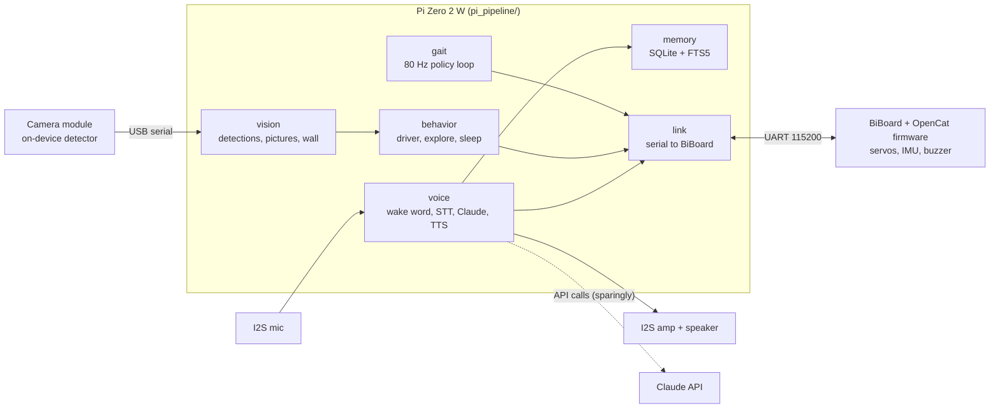

# Architecture

How the pieces of G2 fit together: the hardware, the software that runs on each side, and the seams between them. This page is the map; the detail pages it links to are the territory. What is deployed and working right now: [`STATUS.md`](STATUS.md). A plain-language tour: [`how-it-works.md`](how-it-works.md).

## Two machines and a robot

| Where | What runs | Code |
|---|---|---|
| **Robot** (Petoi BiBoard, ESP32) | Petoi's OpenCat firmware: servo control, built-in skills (`kwkF`, `ksit`, `d` …), the IMU stream, its own voice module and buzzer | not part of this project; reference: [`hardware/petoi-firmware-reference.md`](hardware/petoi-firmware-reference.md) |
| **Pi** (Zero 2 W, on G2's back) | Everything G2 decides: voice, memory, vision, behavior, the 80 Hz gait loop. Deployed with `rsync` | `pi_pipeline/` |
| **Dev machine** (Mac) | Simulation training of the walking policy, ingest and calibration of real-robot logs, tools | `rl_training/`, `tools/` |

The Pi and the BiBoard talk over a 3-wire UART (TX/RX/GND, data only); the Pi has its own battery. The camera (Grove Vision AI V2) is a separate USB device on the Pi and runs object detection on itself. Wiring and parts: [`hardware/as-built.md`](hardware/as-built.md).

## The design rule: mock behind every interface

Every hardware-specific dependency sits behind a small interface with a mock or laptop implementation and a real one, so the whole pipeline runs and is tested on a dev machine with no hardware, and moving to the Pi is configuration:

| Interface | Dev machine | On the robot |
|---|---|---|
| `Actuator` | `MockActuator` (logs commands) | `SerialActuator` (OpenCat serial) |
| `TTS` | macOS `say` / Piper | Piper to the Pi speaker |
| `STT` | typed text / Vosk | Vosk on the Pi mic |
| `WakeWord` | always awake / Vosk | Vosk |

`pi_pipeline/app/` is the only place with real I/O wiring; everything else takes injected dependencies. The test suite needs no network, audio or API key.

## The subsystems

Each is an independent module; they reach each other only through small, deliberate seams.

| Subsystem | Job | Seam to the rest | Detail |
|---|---|---|---|
| **Voice** (`voice/`) | Wake word, speech to text, Claude call, text to speech; local commands that never call the API (stop, floor, sleep, walk for N seconds) | `Memory.recall` before a Claude call, `Memory.record` after; `perform_skill` tool to the link | [`guides/voice-commands.md`](guides/voice-commands.md), [`plan-detail/phase7-voice.md`](plan-detail/phase7-voice.md) |
| **Memory** (`memory/`) | Persistent exchange log (BM25 search) plus short facts G2 saves itself with the `remember` tool; sleep-time consolidation | one function pair on the voice loop | [`plan-detail/phase9-memory.md`](plan-detail/phase9-memory.md) |
| **Behavior** (`behavior/`) | Autonomous behavior. `BehaviorDriver.tick()` reads inputs and returns an ordered list of `Effect`s; it never touches I/O. `bindings.py` maps effects to real sinks. Composes the mode controller, exploration (a stationary "attentive" tier and a voice-armed "roam" tier), idle posture, sleep, enrollment, thermal governor, chirps, emergency stop | `Effect` list out; sensors and detections in | [`guides/exploration-mode.md`](guides/exploration-mode.md) |
| **Personality** (`personality/`) | Composable traits (curiosity, mood, bonds …) that add to the Claude system prompt and to the behavior parameters | `Personality.system_prompt()`, `behavior_params()`, `cues()` | `personality/` code |
| **Vision** (`vision/`) | Camera feed, detections, pictures, wall-distance reading, recognition by instance (`object_gallery`) | detections to the behavior layer; scene text to the voice layer | [`vision/README.md`](vision/README.md) |
| **Gait** (`gait/`) | The 80 Hz loop (`run_gait.py`): a learned residual on the scripted `wkF` walk, exported to ONNX, plus heading hold, stand-up ramp, thermal and jam guards, carpet detection, fall guard | commands through the link; IMU in | [`guides/gait-deployment.md`](guides/gait-deployment.md), [`rl/walking-policy.md`](rl/walking-policy.md) |
| **Link** (`link/`) | The one shared serial link: reconnects, builds command strings, refuses dangerous commands, traces to a JSONL file | everyone sends through it | `link/` code, [`hardware/petoi-firmware-reference.md`](hardware/petoi-firmware-reference.md) |
| **Diagnostics, power, supervision** (`diag/`, `power/`, `util/`) | Per-session event log plus black-box ring buffer, control-loop watchdog, worker supervisor, Pi power levers | used by all | [`hardware/diagnostics.md`](hardware/diagnostics.md), [`hardware/pi-power.md`](hardware/pi-power.md) |
| **Telemetry** (`telemetry/`) | Writes every walk to an automatic log with a sidecar (floor, policy, hardware epoch); feeds the real-data pipeline | files on disk | [`rl/real-data-pipeline.md`](rl/real-data-pipeline.md) |

Feature flags (`features.py`, set by `G2_FEATURES`) gate every major subsystem so bring-up can enable one thing at a time: [`guides/feature-flags.md`](guides/feature-flags.md). Environment switches: [`guides/settings-switches.md`](guides/settings-switches.md).

## How a walk happens

1. A command arrives (voice, exploration, or a CLI walk) with a speed and heading.
2. The gait loop builds an observation from the IMU stream and the last joint commands, runs the ONNX policy, and adds its residual (bounded to ±30°) to the scripted `wkF` joint targets.
3. A closed-loop front-left foot trim holds the starting heading when enabled.
4. Guards run on every tick: stand/fall, thermal (I²t servo heat estimate), jam, battery under load. A critical reading rests the legs.
5. Joint commands go out through the link to the BiBoard. The stand-up that starts any walk uses an eased 0.8 s ramp.

## How training reaches the robot

Simulation training in PyBullet with Stable-Baselines3 (`rl_training/opencat-gym/`) produces a policy; `export_onnx.py` writes the `.onnx` and a `.onnx.json` sidecar (residual scale, command cadence). Only that pair and `pi_pipeline/` are deployed to the Pi, never `rl_training/`. Real-robot logs flow back: Pi autolog, then ingest gates on the Mac, then numbered calibration snapshots that the next sim runs can use. Pipeline details: [`rl/training-upgrade-2026-10.md`](rl/training-upgrade-2026-10.md), [`rl/real-data-pipeline.md`](rl/real-data-pipeline.md), [`guides/gait-deployment.md`](guides/gait-deployment.md).

## What is deliberately not here

- No learned vision inside the walking policy (tried and closed: [`archive/rl/vision-in-gait.md`](archive/rl/vision-in-gait.md)); vision picks a scripted skill or slows the speed command from above the frozen gait.
- No fork of the OpenCat firmware.
- Claude API calls are used sparingly; anything that can be a local rule, table or small model on the Pi is.
- The Petoi AI Head and the robot-arm module are not part of the running build: [`planned/`](planned/README.md).
