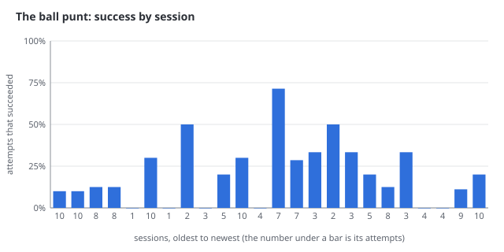
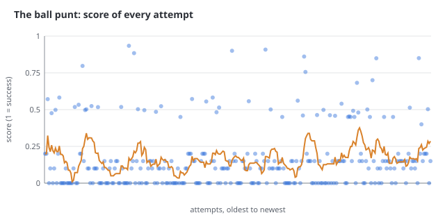
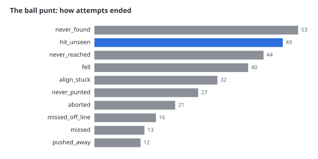
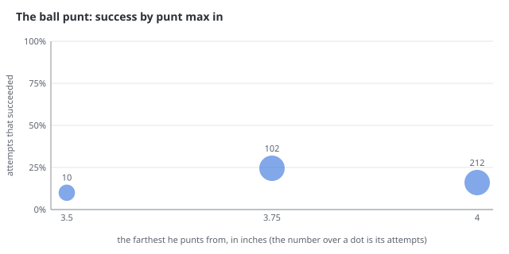
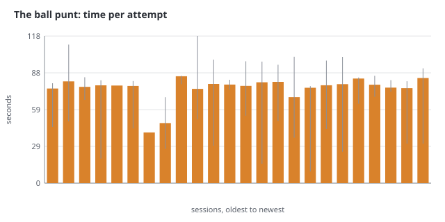

# The ball punt

The ball punt is the first goal and the one with the most history. With the arm fitted, G2 finds a green treat ball on the floor, walks up to it, lines the claw up and punches it, then watches where it went. Each attempt is scored, and over many sessions he tunes how far he punches from, how he lines up and how he searches. How goals work in general is on the [Goals](README.md) page; starting and stopping a session is in [Goals: running them](../guides/goals.md).

An attempt
----------

1. G2 stands at rest, then looks for the ball. If it is not in front of him he does a claw look: the arm is raised and pans left, right and centre, and the camera reads the ball in each picture.
2. He walks toward it in short steps, checking the camera between them. The close steps use Petoi's scripted walk because it stops precisely; turns to line up use the firmware's left and right turn skills.
3. Near the ball he lines the claw up with small turns until the ball sits on the claw's line, and keeps a distance from any wall (a wall hit ends the attempt as "ball by the wall" and does not count against the punt).
4. He punches. The arm's lunge is the same movement every time; its length and where he punches from are settings.
5. About a second later he takes one picture straight ahead and judges it: the ball gone from in front of the claw, or at least 2 inches farther away, is a punt. Still at the claw is a miss.
6. The "active look" can follow a rolling ball with the claw for a few seconds after the punch, so a punt that left the picture is still seen.

He says short cues as he goes ("searching", "target acquired", "punting") and "Got it." or "Missed." at the end.

How it ends
-----------

The scorer gives each attempt an outcome code. The common ones:

- punted: the ball moved at least 2 inches (a success).
- never found: the ball was not seen in the search.
- never reached: he saw it and could not get close enough.
- align stuck: he could not get the claw lined up with it.
- never punted: he got within 2 inches and did not punch.
- hit unseen: the punch happened and the ball was not seen afterwards.
- missed off line: the ball moved, but off to the side of the line.
- fell: he went over. A fall after a good punt keeps the punt's score.

Partial credit is given for getting further (finding it, approaching it, lining up), so a failing session still shows which stage is the weak one.

What he learns
--------------

About thirty settings are in play, and he works on one at a time: how far he punches from, how many nudges come before the punch, the size of the alignment pulses, the search turns, the claw's pan and lift during the look, and when he gives up. Each value tried has its own record. The operator can pin, limit or undo any of them.

The charts
----------

The charts are drawn from the goal journal (see [Goals](README.md) for how to read them).

