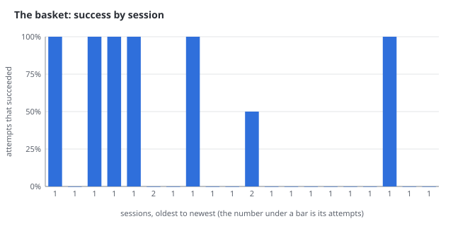
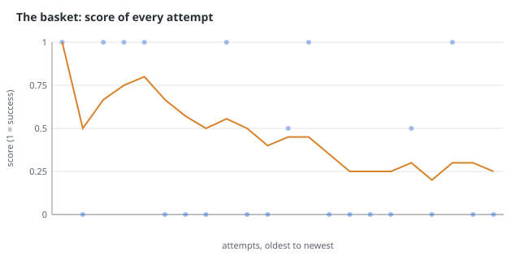
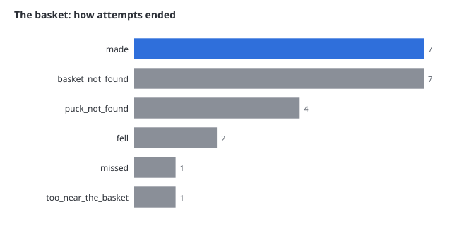
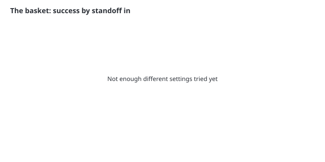
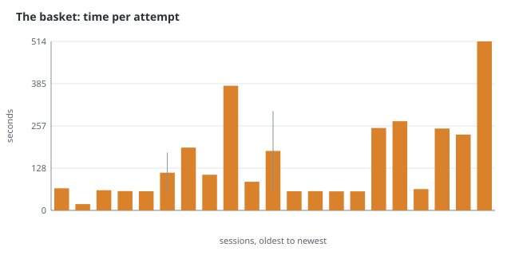

# The basket

The basket is the newest goal. G2 picks a puck up, throws it into a clear tub 16 inches away and works out whether it went in, which is harder than it sounds because the tub is clear and the puck lands out of sight of the camera. If it missed, he finds the puck, picks it up, lines up on the tub again and throws again. How goals work in general is on the [Goals](README.md) page; starting a session is in [Goals: running them](../guides/goals.md); what has been tested on the robot is on the [status](../STATUS.md) page.

Start: G2 at rest with the arm fitted, the puck touching the claw tip and the tub about 16 inches straight ahead, voice service running.

An attempt, step by step
------------------------

1. Pick up and throw. G2 picks the puck up if he is not already holding it and throws it with the scripted lob.
2. Look. After the throw he raises the claw in the attention pose and takes three pictures (left, right, centre). The tub is found by the colour of the tape on its rim; a puck on the floor is found as a compact, strongly coloured blob.
3. A puck seen on the floor outside the tub is a miss, and he goes straight to fetching it.
4. A puck not seen is a question, not a miss: a puck inside the clear tub is only a few coloured pixels from 16 inches. If the tub is not in the look at all, he walks forward in short bursts, looking after each, until it reads.
5. The confirm look. He walks up to within about 7 to 13 inches of the tub and takes quick pictures. A puck inside counts as a make only when the blob is puck-shaped for that tub, no puck is seen on the floor in the same picture, and two pictures agree on where it is inside the tub.
6. A make ends the session: he lies down and the operator takes the puck out.
7. A miss with nothing inside starts the circle search. He walks up to the tub, pivots about 90 degrees away and walks arcs round it, taking one picture after each arc. A puck in the picture ends the search; the tub in the picture means the arc was too tight and he turns outward. Two laps without finding the puck end the session at rest.
8. When he finds the puck he picks it up. The last walk before the pick-up moves him about 8 inches whatever distance is asked, so he first brings the puck to 8 inches from the claw tip (backing up if it is nearer), looks again, turns onto it and only then makes the last walk. After that walk he takes a quick picture and compares the puck with the pick-up spot, where it sat in the calibration pictures taken with the puck 2 inches from the claw tip (base near row 192, centre near column 118). A puck off to the side gets a small turn and one that is too near gets a short back-up, up to two corrections, and then the pick-up. A puck too far gets no correction yet, because a forward walk moves him about 8 inches whatever is asked.
   The close look only trusts a blob as wide as a puck (28 to 66 pixels), and the floor finder can overrule "at the spot" when it reads the puck well off to one side. When the puck is not at the spot after the corrections, he backs up 4 inches and looks again instead of picking blind (twice at most). A puck last seen within 5.5 inches that then vanishes is under the claw: he backs up and looks instead of scanning round. After the pick-up the puck counts as held only when it sits in the jaw; otherwise he backs up 3 inches and looks, and a puck seen on the floor means the pick-up missed. A puck seen on the floor while he lines up with it held means it was dropped, and he fetches it again.
9. The line-up. He scans for the tub, then walks or backs up until the camera reads the shot distance, squaring up to the tub after any back-up (a back-up curves him aside). Then he throws again, holding the puck.

He says "searching for the puck" when a search for the puck begins, "searching for the basket" when he is looking for the tub, "target acquired" when he finds the puck, and "Got it." or "Missed." at the end of an attempt.

Scoring and learning
--------------------

A make is the only success. A miss earns half a point when he finds the puck, picks it up and lines up for another throw, and nothing otherwise. He tunes the distance he throws from, which way he aims, how far short of the puck the last walk stops, the last blind step, and how exact the line-up has to be. The strength of the throw stays fixed.

What makes it hard
------------------

- The camera is on the claw and looks forward and slightly down, so it sees only what is ahead of him; a puck beside or behind him is out of view until an arc brings it ahead.
- The tub and the puck are both warm colours, and the finders tell them apart by shape and position as well as colour. A tub with a different tape colour is planned to make this easier.
- A forward walk is a fixed chunk of about 8 inches, so fine approaches use back-ups and turns.
- Light changes the colour of the tape, which is why the tub finder has a second, dimmer test.

The charts
----------

The charts are drawn from the goal journal (see [Goals](README.md) for how to read them). The basket has far fewer attempts than the ball punt, so its charts are sparse and several settings have been tried only a few times.

