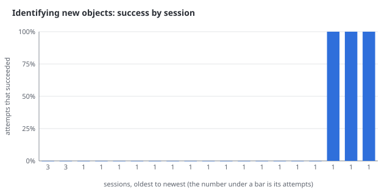
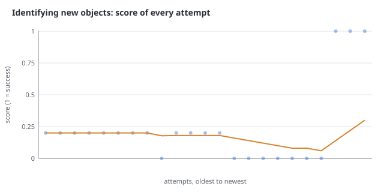
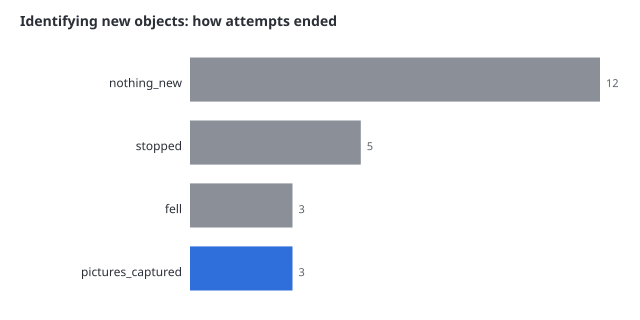
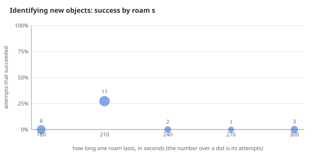
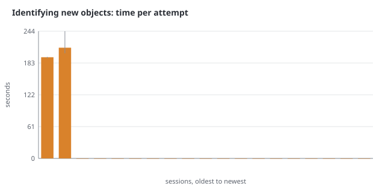

# Identifying new objects

In this goal G2 roams a room looking for things he does not recognise yet and takes pictures of them, so that they can become recognition data. It is the goal that feeds his vision: he finds and photographs, and a person names what is in the pictures afterwards. How goals work in general is on the [Goals](README.md) page; starting a session is in [Goals: running them](../guides/goals.md).

Start: "G2, find new objects" (or "G2, object goal"), in any room, with the head or the arm fitted. A session is three roams of about three minutes, ten minutes at most.

An attempt is one roam
----------------------

1. G2 explores. A background look keeps asking whether something that matches no named object is in view: not a person, and not the base of a wall.
2. When something is, he takes the picture routine and files the survey pictures under the room he was told he is in.
3. Each picture gets a suggested label: the closest object already named in the gallery, or the camera's own label when it fired, or "does not know" with the closest name. He never names anything himself; each suggestion is accepted or changed on the review page, or answers when he asks "what am I looking at?".

Scoring
-------

- Pictures captured: three or more usable survey pictures during the roam. The success. A usable picture is a survey picture, with no person in it, sensibly exposed.
- Few pictures: some usable pictures, but fewer than three. Part credit.
- None usable: pictures were taken but none was usable. A miss.
- Never found: no picture stop at all. A miss.
- Fell: a failure. Stopped: the operator stopped it, and it is not counted.

The old rule scored a roam by whether it added a new gallery candidate. That could never happen, because survey pictures wait for review before they reach the gallery, so every roam scored as finding nothing new. The scoring rule changed once this was seen, and the charts start a new line at that change.

What he learns
--------------

He tunes how long a roam lasts, how often he looks for something new, how long he goes without a picture before taking one anyway, and how long before he stops being picky. Nothing here calls the Claude API.

The charts
----------

The charts are drawn from the goal journal (see [Goals](README.md) for how to read them). This goal has the fewest attempts of the four, most of them scored under the old rule, so read the charts as a record of what has happened rather than a trend.

