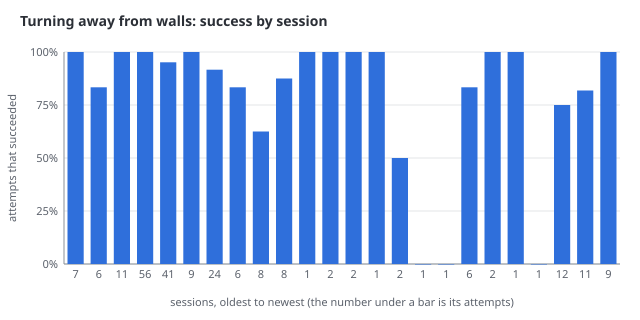
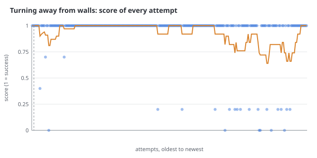
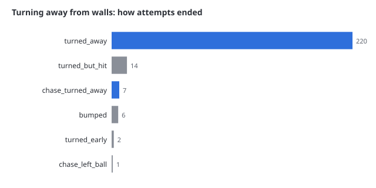
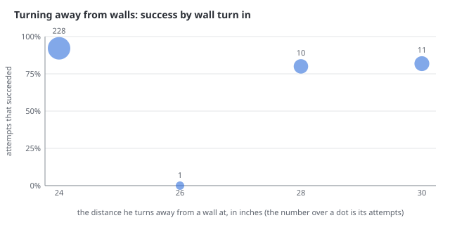

# Turning away from walls

Turning away from walls is the one goal that is always on. G2 is never told to practise it: every exploration roam and every ball chase that meets a wall counts as an attempt, so he tunes it all the time and in every mode. How goals work in general is on the [Goals](README.md) page; the operator's side (reading what he learned, changing the order of the goals) is in [Goals: running them](../guides/goals.md).

It ranks above the ball punt: he always turns away from a wall, also while chasing the ball.

An attempt is one wall encounter
--------------------------------

While exploring, an encounter ends one of four ways:

- Turned away: he turned and did not touch the wall afterwards. A success.
- Turned early: he turned while the wall was still well over 12 inches away. Also a success, but it votes for turning later, because he was more careful than he needed to be.
- Turned but hit: he turned and still touched the wall within 8 seconds. A failure; he should turn sooner and farther.
- Bumped: he touched a wall without turning first. A failure; he should turn and look sooner and stop his walks shorter.

While chasing the ball the outcomes are the same with a chase prefix, plus one of their own: leaving a ball that lies nearer a wall than he allows himself to go. That is a miss that votes for going closer, and it does not count against the punt.

What he learns
--------------

- How far from a wall he turns away, how far away a single look at a wall is enough to act on, how many degrees he turns, how far from a wall he stops his walks, and how close he gets before he starts looking fast. These are his exploration settings.
- How close to a wall he lets himself go while chasing the ball. It starts at 10 inches and never goes below 4.
- Bumps push the distances out and the too-careful outcomes pull them in, so they settle where he turns in time without wasting room.
- He learns in the wall reading's own inches, calibrated or not, so a consistent error in the reading cancels out. A new calibration starts fresh records from his old settings, carried over so he turns at the same real distance.

The charts
----------

The charts are drawn from the goal journal (see [Goals](README.md) for how to read them). An encounter has no duration, so there is no time chart. Most encounters end well, so the success rate sits high, and the interesting part is which outcomes are left.

