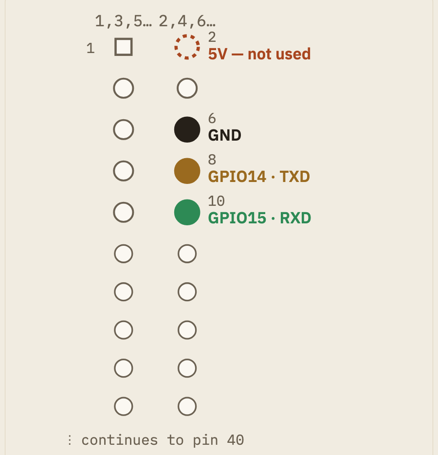

# Pi, PiSugar and BiBoard build notes

Step-by-step build history for connecting PiSugar, the Pi Zero 2 W and BiBoard: parts list, Pi port orientation, PiSugar orientation, BiBoard header preparation, the three-wire link, and the original annotated photos. The wiring as a reference is in [`blueprints/wiring/g2-wiring-guide.html`](../../blueprints/wiring/g2-wiring-guide.html); mounting is in [`blueprints/mounting.md`](../../blueprints/mounting.md); the microphone and amplifier build is in [`i2s-audio-build-log.md`](i2s-audio-build-log.md).

## Before you start

### What you'll need

- [ ] Raspberry Pi Zero 2 **WH** (header pre-soldered)
- [ ] PiSugar S, with its 4 mounting screws (included in the PiSugar box)
- [ ] BiBoard V1 — check whether Petoi included a ready-made BiBoard&harr;Pi
      cable in the Bittle X box before doing anything below; if so, skip to
      Step 3
- [ ] A 5-pin header to solder onto BiBoard, if one isn't already there
- [x] Female-to-female Dupont jumper wires — 40pc/10cm in hand (2026-09-18).
      Still need a couple of **longer** ones (20&ndash;30cm), not just the
      standard short ones, once the final mount position is decided; see
      [Step 5](../../blueprints/mounting.md#step-5--mount-the-assembled-stack-to-the-frame)
- [ ] Soldering iron + solder, only if BiBoard's header isn't already
      populated
- [ ] M2 pan-head self-tapping screws, small mixed assortment (6&ndash;12mm)
      — see [Screws to buy](../../blueprints/mounting.md#screws-to-buy) below
- [ ] A way to mount the assembled stack to the frame — **not yet solved,
      on hold until the frame arrives**; see
      [Print the standoff clip](../../blueprints/mounting.md#print-the-standoff-clip) below. Only
      Step 1 (Pi+PiSugar) is actually mount-independent — Steps 2&ndash;4
      need BiBoard itself, which ships as part of the frame kit **unassembled**
      (Phase 4's "Assemble Bittle X V2," ~40&ndash;90 min), so they're
      hardware-blocked until the frame both arrives and is built, not just
      Step 5.

### Get oriented: Pi Zero 2W ports

Before wiring anything, know the board. Top-down, GPIO header along the top
edge, three ports along the bottom:

*(Image not included: third-party artwork. See [the vendor's page](https://www.raspberrypi.com/documentation/computers/raspberry-pi.html).)* Top-down port map of the Raspberry Pi Zero 2W: 40-pin GPIO header along the top edge with pins 2 (5V, not used), 6 (GND), 8 (GPIO14/TXD), 10 (GPIO15/RXD) called out; microSD slot on the left edge; mini-HDMI, a micro-USB "USB" data-only port, and a micro-USB "PWR IN" port along the bottom edge; unused CSI camera port on the right edge

- **PWR IN** is the micro-USB port at the far end of the bottom edge,
  farthest from the mini-HDMI — silkscreen reads `PWR IN`. This is where a
  bench power supply goes.
- **USB** is the middle micro-USB port, for data only (keyboard, USB-gadget
  mode). **Powering the Pi through this port is the #1 first-timer
  mistake** — it may not boot, or boot erratically. The two ports are
  physically identical; only the tiny silkscreen text tells them apart.
- The **microSD slot** is on the short edge, opposite the CSI camera
  connector (unused on G2 — vision runs through BiBoard's Grove module).
- **No power button.** The Pi boots the instant power is applied. To turn
  off: `sudo shutdown now` over SSH, wait ~10s for the LED to go dark, then
  unplug.
- The Zero 2 W takes **5V over micro-USB** (not USB-C like the Pi 4/5). For
  bench setup (before PiSugar is attached), power from a wall adapter into
  **PWR IN**. Once PiSugar is on (Step 1), you charge through *PiSugar's
  own* micro-USB port instead, and it feeds the Pi through the pogo pins.

## Step 1 — Mount PiSugar to the Pi ✅ done (2026-09-18)

Bench work — no BiBoard needed, can happen any time.

*(Image not included: third-party artwork. See [the vendor's page](https://docs.pisugar.com/docs/product-wiki/battery/pisugar-s-series).)* PiSugar S board, top view

Align PiSugar's 4 screw holes underneath the Pi and secure it with the
included screws.

**Orientation matters — get it wrong and PiSugar will not power the Pi, with
no obvious sign anything is wrong.** The 4 mounting holes are spaced
symmetrically, so PiSugar physically bolts on in **two different 180°
rotations** — screws thread in fine either way. Only one of them is
electrically correct:

- **Correct:** PiSugar's own micro-USB charging port, power switch, and
  battery end up under the Pi's mini-HDMI/USB-port edge. PiSugar's pogo-pin
  end ends up under the Pi's GPIO header edge.
- **Wrong (but bolts on just as easily):** PiSugar rotated 180° from that —
  pogo pins land on bare PCB under the middle of the board, nowhere near the
  header.

Confirmed 2026-09-17 the hard way, after PiSugar was originally assembled in
the wrong rotation and showed no power to the Pi (see the background section
below for the full diagnostic trail). Before fully tightening the screws,
hold the two boards edge-to-edge and visually check that PiSugar's pogo pins
land on the Pi's header solder-joint row (the double row of small pads at
the base of the 40-pin header, visible from the underside) — don't rely on
the screw holes fitting as confirmation, since they fit either way.

**What the pogo pins actually contact:** 5 spring-loaded pogo pins (not 2),
landing directly on the underside solder joints of the Pi's own 40-pin
header — not a separate test-pad cluster elsewhere on the board. Confirmed
three ways: PiSugar's official FAQ states pogo pins contact "the bottom of
the Raspberry Pi's GPIO pins"; PiSugar's own PCB legend identifies one of
the 5 contacts as SCL, tied to GPIO3 (physical header pin 5) for
auto-startup; and directly visible in a macro photo of the assembled stack
(pins pressed against the header pin bases). The likely signal mapping is
5V/5V/SCL/GND/GND, using header pins in the 2/4/5/6 range — not
independently confirmed pin-by-pin, but consistent with everything above.

No wiring, no soldering — but do check the orientation before this leaves
the bench, since it's easy to reassemble correctly later but easy to miss
entirely if you only check that the screws went in.

## Step 2 — Prepare BiBoard's Pi header

The connector is a 5-pin header at BiBoard's top edge, just above **G1**
&mdash; a Grove socket, not a leg-servo connector (`specs.md` confirms
G1&ndash;G4 are Grove sockets: G1=UART2, G2=I&sup2;C, G3/G4=analog in; the
leg servos use a separate connector set, numbered 0 and 8&ndash;15).
This edge is also, per Petoi's official BiBoard V1 wiring diagram
(`4-connect-the-wires/biboard-v1.md`), the edge that faces the robot's
**head** &mdash; joint 0 (the head-pan servo) sits directly against it.
That matters for where the Pi mounts; see
[Step 5](../../blueprints/mounting.md#step-5--mount-the-assembled-stack-to-the-frame) below.

*(Image not included: third-party artwork. See [the vendor's page](https://docs.petoi.com/apis/raspberry-pi-serial-port-as-an-interfac/for-biboard-v1).)* BiBoard V1 front, with the 5-pin Raspberry Pi header outlined near the top edge

If it isn't already populated, solder a 5-pin header there. Left to right:

| Pin | Label |
|---|---|
| 1 (square pad) | TX2 |
| 2 | RX2 |
| 3 | GND |
| 4 | +5V |
| 5 | +5V |

**Done 2026-09-29** — 5-pin female header soldered to BiBoard.

## Step 3 — Wire the Pi to BiBoard

Three wires, crossed — one board's "sending" line goes to the other's
"listening" line:

| From (BiBoard) | To (Pi) |
|---|---|
| TX2 | pin 10 (GPIO15, RXD) |
| RX2 | pin 8 (GPIO14, TXD) |
| GND | pin 6 |

Leave BiBoard's two +5V pins and the Pi's pin 2 (5V) **unconnected** — PiSugar
is already powering the Pi.

Both sides at once, wires drawn crossing between them — the fastest way to
see exactly which pin goes where:

**Why TX and RX cross:** one device's "I'm sending" line has to reach the
other device's "I'm listening" line. Pi TXD carries the Pi's outgoing data,
so it plugs into BiBoard's RX2 (BiBoard's incoming). BiBoard's TX2 carries
BiBoard's outgoing data, so it plugs into the Pi's RXD (the Pi's incoming).
Ground doesn't cross — it just connects the two boards' references together.

BiBoard side, zoomed &mdash; the three pins to wire are checked, the two +5V
pins are marked to skip:

*(Image not included: third-party artwork. See [the vendor's page](https://docs.petoi.com/apis/raspberry-pi-serial-port-as-an-interfac/for-biboard-v1).)* Close-up of BiBoard's 5-pin header: TX2, RX2, GND checked; both +5V pins marked with an X

Pi side, the other end of the same 3 wires &mdash; the relevant pins are the
first 5 columns of the header, nearest the microSD slot. Pin 1 (square,
top-left) orients you:

*(Image not included: third-party artwork. See [the vendor's page](https://www.raspberrypi.com/documentation/computers/raspberry-pi.html).)* Raspberry Pi Zero 2 W, with the GPIO header outlined near the top edge

*(Image not included: third-party artwork. See [the vendor's page](https://www.raspberrypi.com/documentation/computers/raspberry-pi.html).)* Close-up of the Pi's header: pin 1 marked with a white square, pin 2 (5V) marked to skip, pins 6/8/10 checked for GND/TXD/RXD

(The photo above shows a bare Pi Zero 2 W with unpopulated pads — your WH kit
ships with the header already soldered, so there's nothing to solder on the
Pi side, only on BiBoard's, in Step 2.)

**If mounting at the back edge** (see Step 5 — the preferred option), this
wire run is the *longer* one — use the 20&ndash;30cm jumpers here, not the
standard short ones.

## Step 4 — Before powering on

- [ ] Both of BiBoard's +5V pins are empty — no wire on either
- [ ] The Pi's pin 2 (5V) is empty
- [ ] BiBoard TX2 goes to Pi **pin 10**, not pin 8 (they're easy to swap)
- [ ] All 3 wires are seated firmly at both ends

## Reference

Full pinout, both boards:

| | BiBoard | Pi |
|---|---|---|
| Ground | GND | pin 6 |
| BiBoard sends / Pi receives | TX2 | pin 10 (RXD) |
| Pi sends / BiBoard receives | RX2 | pin 8 (TXD) |
| Power (not wired) | +5V, +5V | pin 2 |

### Pi 40-pin header, full reference

Only pins 2, 6, 8, 10 are used in this build (Step 3) — the rest shown for
context, since G2's own future GPIO use is unplanned:

Pi pin numbers are standard across every 40-pin Raspberry Pi, including the
Zero 2 W. BiBoard's pin order is confirmed from Petoi's own official
BiBoard V1.0 board diagram.

This diagram, the combined wiring diagram (Step 3), and the port map
(Before you start) used to live in two separate artifacts — "G2 Electronics
Wiring" and "Pi Zero 2 W Port Map." Both are now fully folded in and
deleted, so there's one place to look, not three.

Source diagram (both sides of BiBoard, all 17 numbered components):
[Petoi's official wiring diagram](https://docs.petoi.com/apis/raspberry-pi-serial-port-as-an-interfac/for-biboard-v1).

**Note:** BiBoard V1's spec sheet lists Pi compatibility as "Pi 3A+, 4, 5" —
the Pi Zero 2 WH isn't named. The pins used here (5V/GND/GPIO14/GPIO15) are
identical across every 40-pin Pi header including the Zero 2 W, so this is
expected to work regardless — worth a quick visual check of the header once
both boards are in hand.

### Sources

- [For BiBoard V1 | Petoi Doc Center](https://docs.petoi.com/apis/raspberry-pi-serial-port-as-an-interfac/for-biboard-v1)
- [BiBoard V1 Guide | Petoi Doc Center](https://docs.petoi.com/biboard/biboard-v1-guide) — source of the official board diagram
- [4 Connect the Wires — BiBoard V1 | Petoi Doc Center](https://bittle.petoi.com/4-connect-the-wires/biboard-v1.md) — official wiring diagram showing BiBoard's orientation on the frame (head vs. tail), used in Step 5
- [PiSugarS Series | PiSugar Docs](https://docs.pisugar.com/docs/product-wiki/battery/pisugar-s-series)
- [PiSugar S | Tindie](https://www.tindie.com/products/pisugar/pisugar-s-battery-for-raspberry-pi-zero/) — "bottom connection... without affecting GPIO expansion," confirming PiSugar mounts under the Pi and never touches the GPIO header
- [Raspberry PI Zero 2W TOP 02.jpg | Wikimedia Commons](https://commons.wikimedia.org/wiki/File:Raspberry_PI_Zero_2W_TOP_02.jpg) — CC BY-SA 4.0, source of the Pi Zero 2 W photos above
