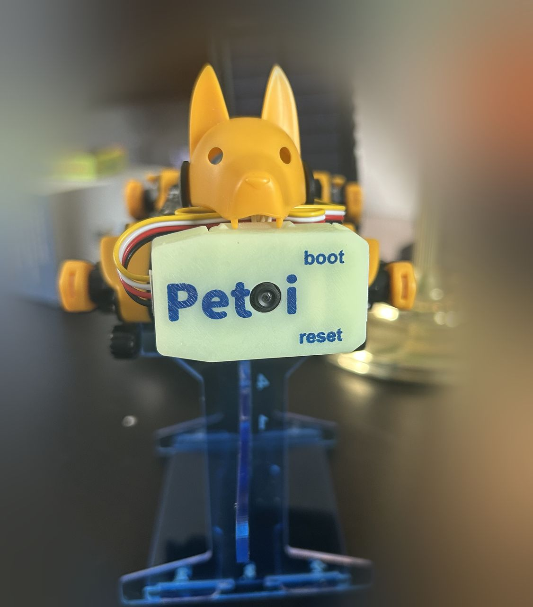
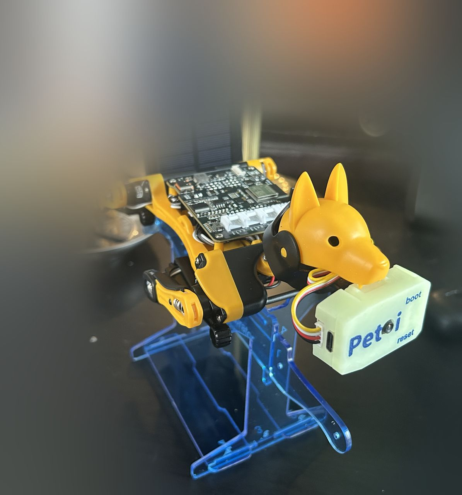

# Camera and vision

Everything about G2's camera, the on-device detection model, and building /
capturing data for it.

- [`picture-library.md`](picture-library.md): What happens to a picture G2 takes while exploring, which folder holds what, and which parts can be rebuilt. The pictures are local only: trainingdata/ is gitignored, nothing is uploaded, and the repository holds none of
- [`detection-layer.md`](detection-layer.md): Architecture: one model slot, three roles (safety / interaction / objects), a model-manager that swaps by mode, and the measured on-device detector behaviour.
- [`person-recognition.md`](person-recognition.md): B15 — individual recognition + the "G2, meet X" enrollment flow.

### Capturing data and models

- [Vision model training](../guides/train-vision-model.md): Start here for a model: the capture, curate, train and deploy walkthrough, and why the frozen camera firmware limits which models run.
- [`capture-checklist.md`](capture-checklist.md): The routine to run for every capture session.
- [`downloaded-models.md`](downloaded-models.md): **Models downloaded from the internet (outside the repo):** source, size, SHA-256, what each was checked against, who approved it, and what those checks do and do not show

The runtime code is `pi_pipeline/vision/` (feed / avoidance / cliff-guard /
scene). The SenseCraft single-class flow is [`../guides/train-vision-model.md`](../guides/train-vision-model.md).

Reviewing the pictures G2 takes
-------------------------------

Where the pictures live and how they flow from the Pi to the training data: [`picture-library.md`](picture-library.md).

`g2pics` opens a local review page of the pictures G2 saved while exploring: thumbnails with an X on each (a Trash with Undo; only "Empty trash" deletes for good), a Name button, quality and duplicate filtering, and Promote, which copies a labelled picture into the training set the Pi's gallery learns from. `g2pics pull` copies the pictures from the Pi first. The page is `tools/g2_review.py`; all helpers: [`../guides/shell-helpers.md`](../guides/shell-helpers.md), tool index: [`../../tools/README.md`](../../tools/README.md).
